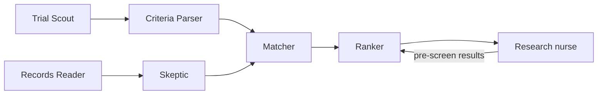

<h1 align="center">
  <a href="https://trial-match-ebon.vercel.app/">
    <picture>
      <source media="(prefers-color-scheme: dark)" srcset="docs/logo-dark.png">
      
    </picture>
  </a>
</h1>

<h4 align="center">Find the right patients for your clinical trial, before the trial sits empty.</h4>

<p align="center">
  
  
  
  
  
  
</p>

<p align="center">
  <a href="https://trial-match-ebon.vercel.app/app/"><b>Live demo</b></a> •
  <a href="#quick-start">Quick start</a> •
  <a href="#how-it-works">How it works</a> •
  <a href="#results">Results</a> •
  <a href="#safeguards">Safeguards</a> •
  <a href="docs/TrialMatch_write-up.pdf">Write-up</a> •
  <a href="docs/Trial_Match_Pitch.pdf">Pitch deck</a>
</p>

<p align="center">
Trial Match is a multi-agent system that finds eligible patients for recruiting clinical trials. It reads patient records, checks every entry rule against the evidence, and hands trial teams a ranked shortlist of people who are likely to qualify, enrol and stay to the end. A research nurse pre-screens every match, and their results feed back into the next ranking.
</p>

<table align="center">
  <tr>
    <th align="center">Trial team: ranked applicants</th>
    <th align="center">Patient: swipe to apply</th>
  </tr>
  <tr>
    <td align="center"></td>
    <td align="center"></td>
  </tr>
</table>

> [!IMPORTANT]
> **Prototype, not a medical device.** Every patient, trial and hospital in the demo is synthetic. Results are from offline tests and are **not** real-world performance.

---

## The problem

4 in 10 UK trials still have **no patient a month after opening**, and it takes 122 days on average to recruit the first one. Meanwhile 95% of patients say they'd consider a trial, and 63% are never told about one. Finding them today depends on a busy clinician remembering which trials exist and checking 20–30 eligibility rules by hand.

## Quick start

**Try it in the browser:** open the [live demo](https://trial-match-ebon.vercel.app/app/), choose **I'm a clinician**, and pick Dr Amira Rahman. No sign-up needed.

**Run it locally:**

```bash
git clone https://github.com/kaihuang1425/agentic-legacy.git
cd agentic-legacy
pip install -r requirements.txt

python fetch_trials.py                                      # pull recruiting Phase III trials
python run.py --top 10 --out results/                       # rank trials for each patient
python run.py --feedback data/prescreen_outcomes_DEMO.csv   # learn from nurse pre-screens
python build_app.py                                         # rebuild the web app
```

> **Note:** set `GEMINI_API_KEY` to turn on the Gemini agents. Everything else runs without it.

---

### 🔎 Key features

- 📋 **Ranked shortlists for every trial:** applicants ordered by how likely they are to qualify, enrol and complete, not just whether they pass a keyword search.
- 🧾 **Every rule shows its evidence:** each criterion is marked *met*, *not met* or *unknown*, with the line from the record and the trial text quoted.
- ❓ **Unknown is not "no":** an untested biomarker becomes "needs testing", so eligible patients aren't silently dropped.
- 🔁 **Pre-screening feeds back:** nurse results fill gaps in records, correct misread rules and re-tune the ranking.
- 🔒 **The record stays on the device:** Gemini researches online using only public words, and MedGemma reads the findings against the record locally.
- 🌍 **Fairer recruitment:** a small boost for under-represented groups that can only raise a score, never lower one.

---

## How it works

1. **Trial Scout** pulls recruiting trials live from ClinicalTrials.gov.
2. **Criteria Parser** turns each trial's eligibility text into rules: stage, histology, ECOG, biomarkers, PD-L1, prior lines, brain metastases, biopsy and placebo arm.
3. **Records Reader** (MedGemma) extracts facts from clinic letters and records.
4. **Skeptic** throws out any fact it can't quote word for word from the record.
5. **Matcher** checks every rule in fixed code (rules, not AI) and asks for the one missing fact that settles the most trials.
6. **Ranker** scores each patient–trial pair:
   `Score = Eligibility × Feasibility × (1 + 0.2 × Diversity)`
7. **Research nurse** pre-screens the shortlist. Their outcomes flow back into steps 5 and 6.



---

## Results

| Test | Result |
|:---|:---|
| Matching, 45,600 synthetic patient–trial pairs | A plain registry search got **93%** of its "eligible" matches wrong. Trial Match got **0%** wrong and cut trials to review per patient from **16.7 to 1.6** |
| Criteria parser, hand-checked against raw trial text | **92%** of fields correct (58/63) on 8 held-out trials |
| Chat agent | All 11 tests passed on the live model |

> Small samples on synthetic data. Method in [`docs/EVALUATION.md`](docs/EVALUATION.md).

---

## Safeguards

- **People decide.** A nurse pre-screens every match, and the tool never enrols anyone.
- **Names stay hidden.** Trial teams see an ID until the patient says yes.
- **Nothing happens without a tap.** Agents only suggest, and a person confirms every action.
- **Honest limits.** The scoring weights (apart from the biopsy penalty) are our own assumptions and haven't been validated against real enrolment. So far it's built and tested on lung cancer trials, and other diseases are untested.

---

## Data and licences

| Source | Used for | Licence |
|:---|:---|:---|
| [ClinicalTrials.gov API v2](https://clinicaltrials.gov/data-api/api) | Live trial records | Public domain (US NLM) |
| [cBioPortal](https://www.cbioportal.org/) (TCGA LUAD/LUSC, MSKCC NSCLC 2018) | De-identified research records for building the engine | Open access, per study terms |
| PubMed, FDA labels | Researcher agent's public sources | Public |
| Synthetic | All demo patients, trials, sites and pre-screen outcomes | Ours |
| [Unsplash](https://unsplash.com/) (CDC) | Site photography | Unsplash licence |

## Project structure

```
trialmatch/
  criteria.py   # trial text → rules
  match.py      # check, verify, score and rank
  feedback.py   # learn from nurse pre-screen outcomes
  llm.py        # optional Gemini pass
fetch_trials.py · run.py · build_app.py
app/ · docs/ · tests/
```

---

<p align="center">
  Built by <b>Team TrialMatch</b> for <b>AgentVerse 2026</b> · UCL AI Society × Google DeepMind · Biotech track: <i>make the path to patients faster</i>
</p>
