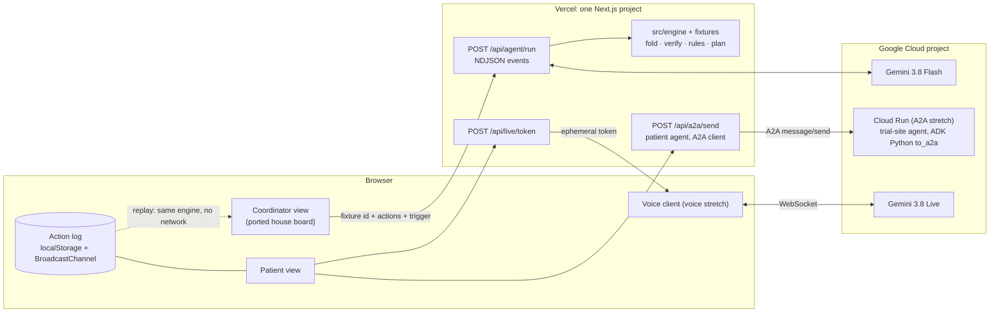

# Relay: implementation plan (Gemini agent, Vercel, Google Cloud)

Written 7 Nov 2026 for the Agentverse 2026 build (judging 8 Nov). Planning only: no app code here. External facts are
sourced in [research-notes.md](research-notes.md) (`[R-n]` = entry n). **Unconfirmed** = no official page confirmed it
today. An adversarial review (Codex, gpt-6.1-sol) has been applied.

## 0. Summary

- **Recommendation: Option B.** One Next.js project on Vercel; the agent is TypeScript over `@google/genai`, calling
  the existing `src/engine` as its tools; the same engine runs replay mode in the browser.
- **Models (checked today):** `gemini-3.8-flash` for extraction, agent and drafting unless the hour-5 eval favours
  `gemini-3.6-flash` (both stable, no shutdown date); `gemini-3.8-live` for voice. The Live preview ids have an
  earliest shutdown date of 17 Nov 2026, so they are out [R-9].
- **Google Cloud's role:** Gemini (key on a billed GCP project), Gemini Live, and for the A2A stretch a separate
  trial-site agent on Cloud Run built with ADK Python. If the owner needs the agent itself hosted on Google Cloud, run
  the same TS agent as a Cloud Run service behind a Vercel route (A′, about +2–3 h). Porting it to Python (A) is not
  worth it.
- **Reassessment never waits on the model.** Document → extract → verify → reassess all trials → plan is a fixed
  pipeline. The model reads the report and afterwards decides, drafts and explains; it never sets a criterion state.
- **Only facts with a verbatim quote that a deterministic check confirms can make a row `supported` or
  `conflicting`**; an unconfirmed value sends its rows to `needs_review`. **State is an action log folded over
  server-owned fixtures**, so clients can't inject facts.
- **Demo centrepiece:** a judge edits the free text of a held-out synthetic report; the agent cites, reassesses,
  picks its next tools in a visible trace and stops at a version-bound human approval. Items only the study team
  can settle are "checked at screening" and don't block "ready for prescreening review".
- Core freeze at hour 12.5, only after a full six-minute rehearsal passes; voice (3 h) and A2A (2 h) each have a
  go/no-go 45 minutes in.

## 1. Recommendation

### 1.1 Comparison (hosting and agent language assessed separately)

| | A: Vercel UI + ADK Python on Cloud Run + Firestore | A′: Vercel UI + same TS agent on Cloud Run | **B: Vercel only** | C: whole Next app on Cloud Run / App Hosting |
|---|---|---|---|---|
| Engine reuse | Port rules/verify/policy/units to Python: two sources of truth | Full | Full | Full |
| Moving parts | Vercel, Cloud Run, Firestore, IAM, proxy | Vercel, Cloud Run, proxy secret | Vercel + Gemini key | Cloud Run or Firebase (Blaze) [R-24] |
| Demo reliability | Two deploys; cold starts unless min-instances [R-21] | Two deploys | One deploy | One deploy; Next 16 on App Hosting **unconfirmed** [R-24] |
| Agent runs on Google Cloud | Yes | Yes | No (calls Gemini on GCP) | Yes |
| ADK in the story | Core | Optional (ADK TS exists [R-6]) | A2A stretch | Optional |
| Browser replay | Possible in all four options | | | |
| Extra hours vs B (estimate) | +6–8 | +2–3 | 0 | +2 (new deploy path) |

### 1.2 Why B

- The engine (`types`, `rules`, `policy`, `units`, `extract/verify`, `extract/llm`, `llm/gemini`) already holds the
  invariants. Wrapping it as tools takes hours; porting it takes a day.
- Vercel fits: 300 s per function on Hobby, 800 s on Pro, with Fluid compute (on by default for new projects
  [R-29]); streaming counts inside the limit [R-15]. The fixed pipeline needs one Gemini call before cards move:
  target ≤8 s to moved cards on the deployed URL, fallback included, measured in hour 5. Vercel Functions now serve
  WebSockets (GA 20 Oct 2026) [R-17], but voice doesn't need them (browser → Gemini Live).
- `@google/genai` 3.0.0 shipped 6 Nov 2026 with breaking changes (default API `v1`, Node ≥22) [R-14]. Pin it exactly
  (`package.json` says `^3.0.0`), run Vercel on Node 22+, keep 2.32.0 as fallback. `generateContent` is now called
  legacy next to the Interactions API but has no shutdown date [R-28]; the engine uses it, so keep it.
- B gives up ADK in the core. The engine session is building its loop on `LlmProvider`, with `FakeProvider` for
  tests; tools are plain functions, so moving the loop to ADK TS later is about 2 h (estimate).

### 1.3 Architecture



**State model.** The client keeps `{fixtureId, actions[]}`. Fixtures (trials, patients, seed documents) ship with the
server and the bundle. Actions are small and allowlisted: `doc.generated` (judge-sheet values), `doc.uploaded` (text),
`facts.extracted`, `fact.corrected`, `proposal.created`, `proposal.decided`, `site.unavailable`, `preference.set`,
`patient.interest`, `consent.given`. `state = fold(fixture, actions)` is pure and lives in `src/engine`, so browser
and server compute the same state. On every request the server re-folds and re-runs the quote and value checks on
every extracted fact, dropping any fact not derivable from its document. Two limits remain. Uploaded text is
client-supplied by nature and nothing can detect real data, so the upload screen says synthetic only and the demo
uses generated documents. Coordinator identity and approvals are simulated; a real deployment needs server-side auth
and storage.

## 2. Repo layout (after flattening `relay/` to the root)

```
app/
  page.tsx                      coordinator queue + details panel (ported house board)
  patient/page.tsx              patient profile, opportunities, conversations
  api/agent/run/route.ts        POST {fixtureId, actions, trigger, mode, baseVersion} → NDJSON RelayEvent stream
  api/unlock/route.ts           demo passcode → httpOnly cookie for live mode
  api/live/token/route.ts       mint one Gemini Live ephemeral token (voice stretch)
  api/a2a/send/route.ts         patient agent: consented payload → A2A client → trial-site agent (A2A stretch)
  api/health/route.ts           mode, model ids, key present (never the key), snapshot date
src/engine/                     existing engine
  state/fold.ts                 fixture + actions → RelayState (pure)
  extract/support.ts            value gate: does the quote support the value? (§4)
  agent/events.ts tools.ts transitions.ts pipeline.ts live.ts replay.ts
src/ui/                         ported board code: kit.ts, tokens.css, coordinator/, patient/, activity/, chat/
src/voice/                      capture worklet, 24 kHz player, captions, Live session wrapper (voice stretch)
services/trial-agent/           ADK Python agent + to_a2a under uvicorn, Cloud Run (A2A stretch)
data/ scripts/ tests/ docs/     as today; tests add fold, gate, pipeline parity and the judge-input grid
```

Names under `src/engine/` that don't exist yet are proposals. Match what the engine session lands: assess,
plan-next-action, alternatives, audit, diff and the agent were not in the tree when this was written [R-33].

## 3. Agent design

### 3.1 One orchestrator, five capabilities

One system prompt, one tool loop. The owner's five capabilities are tool groups shown as labels in the activity panel,
not separate agents: **Evidence Investigator** (extract, evaluate, identify missing), **Trial Scout** (search,
criteria), **Patient Interviewer** (patient requests, explanations), **Referral Coordinator**, approval-gated
(referring-team requests, invitations, status), **Re-matching** (reassess, alternatives).

### 3.2 Tools mapped onto the engine (11: the owner's nine plus two)

| Tool | Args → result | Engine function | Guardrail |
|---|---|---|---|
| `search_clinical_trials` | `{biomarker?, line?, nearCity?, maxMiles?}` → summaries | `data.TRIALS`, `geo.milesFromCity` | Only the 9 encoded snapshot trials are assessable |
| `get_trial_criteria` | `{trialId}` → `{id, kind, plain, text}[]` | `data.getTrial(id).criteria` | Read-only; `text` verbatim from the registry |
| `extract_medical_evidence` | `{docId}` → accepted/rejected keys | `extract/llm` (live) or `extract/rules` (replay) → `verifyCandidates` → value gate | Runs inside the pipeline; the model may only re-run it on a named doc |
| `evaluate_eligibility` | `{trialId?}` → status + open/conflicting rows | `rules.evaluateCriterion`, engine `assess` | Deterministic; no write |
| `identify_missing_information` | `{}` → ranked `NextAction[]` | engine plan-next-action | Proposes only |
| `create_information_request` | `{actionId, audience}` → `Proposal{pending}` | `NextAction.draft` template + `Proposal` | One proposal per run; cannot send |
| `reassess_trials` | `{reason}` → changed trials and rows | assess all + diff | Always the whole portfolio |
| `propose_prescreening_invitation` | `{trialId, siteId}` → `Proposal{pending}` | `Proposal` | Refused unless status is `ready` or `needs_review` and the site is open; only a coordinator can "Invite anyway" (§3.5) |
| `get_referral_status` | `{trialId?}` → buckets, proposals, outbox | `RelayState` | Read-only |
| `find_alternatives` | `{trialId, reason}` → sites/studies | engine alternatives + `geo` | Preferences filter, never override eligibility |
| `explain_for_patient` | `{trialId}` → template text + fact ids | `Assessment` → template | No model-written clinical text |

### 3.3 Runs: fixed pipeline first, bounded agent second

- **Pipeline** (`document_added`, `fact.corrected`, `site.unavailable`): extract, quote and value checks, reassess all
  9 trials, rank next actions. It emits events and commits whether or not the model step after it succeeds. Live
  extraction is one Gemini Flash call with a 6 s timeout; in replay or after the timeout the rules extractor runs,
  labelled as such.
- **Agent step (live):** the model picks the proposal to draft and writes a short note; chat runs here too. It sees
  fact keys, values and dates, statuses and open counts, never document text or quotes. The loop is manual (JS has no
  automatic function calling) and replays the model's own parts so thought signatures survive [R-12]. Caps: 6 turns,
  20 s, `AbortController` on the pending call; what is done is committed and the rest labelled "not finished".
- **Why the evidence path is fixed but the rest is the agent's choice:** in the free-text challenge (§4) the judge
  sees the pipeline cite and reassess, then the agent select its next tools (missing information, a request or an
  invitation proposal, alternatives) in the activity trace, stopping at a version-bound approval (§3.5). The mode
  badge (live / replay) and every tool call stay visible. The fixed part is a deliberate trade: reassessment must
  happen even when the model stalls.
- **Replay:** a fixed policy per trigger calls the same handlers and emits the same events. It covers the fixtures,
  judge-sheet documents and the five chat chips; the free-text challenge, arbitrary uploads and free-text chat need
  live mode, and replay says so rather than guessing.
- **Fallback without duplication:** each trigger carries an idempotency key and its `baseVersion` (log length).
  Actions arrive in one `actions.committed` event at the end, appended only if the log is still at `baseVersion`. On
  `run.error` or a dropped or malformed stream, the client discards staged events and reruns the trigger in replay
  from the same base.
- **Single writer:** the coordinator tab owns the log; the patient tab posts actions to it over BroadcastChannel.
  Log capped at 1 MB client-side (body cap 4.5 MB [R-16]); if localStorage fails, memory plus a visible notice.
- **Model:** `gemini-3.8-flash`, fallback `gemini-3.6-flash` via `RELAY_MODEL` (both stable; same price until 31 Dec
  2026) [R-9][R-25]. Thinking stays default (3.8 Flash rejects `minimal`). No GA Pro exists, and `gemini-4-argon`
  costs about 2.7× Flash per input token until 30 Nov (about 5.3× after); neither is needed. Extraction never mixes
  tools with structured output (Preview) [R-11].

### 3.4 Guardrails

1. Criterion states come only from `rules.ts`. Only facts that passed the quote check and the value gate can yield
   `supported` or `conflicting`; a gate-unconfirmed value yields `needs_review`.
2. **Tool-transition policy in code, not the prompt:** a tool allowlist per trigger, at most one proposal per run,
   invitations only under the §3.2 conditions, no tool that sends, unknown ids return an error result.
3. **Clinical text comes from templates over engine data.** This covers card lines, row reasons, request drafts and
   patient explanations. Gemini writes only chat answers and a one-line note on a draft. Each of its sentences must
   cite a fact or criterion id from tool results and pass a lint: no `%` except a quoted PD-L1 TPS, and none of
   "eligible", "qualif*", "meet(s) every/each/all", "satisf*", "fits", "chance", "likely to benefit", "success". A
   failing sentence is replaced with a template sentence. Live speech (voice stretch) can't be linted before it is
   spoken; it is bounded by a locked system instruction, a field whitelist and no eligibility tools (residual risk,
   §8).
4. Documents are data. The extraction call has no tools. Quotes, rejected candidates and document text never enter
   the agent loop.
5. **Spending endpoints need the demo passcode cookie and a same-origin check.** That covers live `/api/agent/run`,
   `/api/live/token` and `/api/a2a/send`. Each session gets one run in flight and at most 3 Live token mints, plus a
   per-IP rate limit (in-memory, best effort). The public URL defaults to replay.
6. Every document goes through `assertSynthetic` and a patient-id match. Patient-reported answers (chat or voice) sit
   in their own lane and never make a row `supported`.

### 3.5 Status semantics, approvals and verification (all enforced in `fold` and route code, outside the model)

- **At-screening items.** A criterion only the study team can settle is marked `atScreening` (the engine's
  `checkable: false`). Examples: central PD-L1 confirmation (CodeBreaK 202); registry lists that say "including but
  not limited to" (KANDLELIT-007 lists main criteria only). It shows as "Checked by the study team at screening" and
  never blocks status. Derivation: any mandatory `conflicting` → not a match; else any non-screening `unknown` → needs
  evidence; else any non-screening `needs_review` → needs clinical review; else **ready for prescreening review**,
  with "N items checked at screening" on the card.
- **Approvals are version-bound.** `proposal.decided` records patient record version, trial snapshot, a hash of the
  exact `Assessment`, the approved draft text and the recipient. If any of these changes before "send", the approval
  is void and the card returns to pending ("Record changed since approval"). Approving an invitation while open or
  conflicting items remain ("Invite anyway") needs a typed override reason, kept in the audit log.
- **Verification is bound to evidence.** `fact.verified` records `(docId, value, start, end)`. When any of those
  changes (correction, re-extraction, new document version), `fold` clears the verification and the row shows
  "Verification cleared: value changed".
- `Proposal.status` moves `pending → approved → sent (simulated)` or `pending → rejected` only through coordinator UI
  actions (Approve & send, Reject, Undo within the 5.2 s toast). Tools create `pending` proposals and read status,
  nothing else. Each transition is an action plus an `AuditEvent`. Patient "I'm interested" and A2A consent are
  recorded patient actions, not coordinator approvals.

### 3.6 Event stream the UI animates

NDJSON over a streamed `fetch` POST. Replay yields the same objects from an async generator.

```ts
type RelayEvent = { v: 1; runId: string; seq: number; at: string; mode: 'live' | 'replay' } & (
  | { type: 'run.started'; trigger: Trigger; idempotencyKey: string; baseVersion: number }
  | { type: 'step.started'; stepId: string; capability: Capability; tool: ToolName; title: string }
  | { type: 'step.finished'; stepId: string; ok: boolean; summary: string; detail?: unknown }
  | { type: 'fact.cited'; stepId: string; fact: Pick<Fact, 'id' | 'key' | 'value' | 'observedOn' | 'source'>;
      extractor: 'llm' | 'rules'; gate: 'confirmed' | 'review' }
  | { type: 'fact.rejected'; stepId: string; key: string; reason: string }
  | { type: 'assessment.changed'; stepId: string; trialId: string; from: TrialStatus; to: TrialStatus;
      rows: { criterionId: string; from: CriterionState; to: CriterionState }[] }
  | { type: 'action.proposed'; stepId: string; action: NextAction }
  | { type: 'approval.requested'; proposalId: string; kind: Proposal['kind']; summary: string }
  | { type: 'agent.say'; text: string; cites: string[] }
  | { type: 'actions.committed'; baseVersion: number; actions: Action[] }
  | { type: 'run.finished'; changed: number; forward: number; nowConflict: number; unfinished: string[] }
  | { type: 'run.error'; message: string; fallback: 'replay' | 'none' }
);
```

| Event | UI response (board timings; motion budget 120–320 ms) |
|---|---|
| `step.started` / `.finished` | Activity row drops in (220 ms) with an open ring; ring ticks (`Kit.replay(el,'tick',260)`); row expands to its result |
| `fact.cited` | Fact counter rolls; document chip pulses; value becomes a passage link; `gate: 'review'` shows the violet half-glyph |
| `assessment.changed` | Cards update in sequence 170 ms apart: status cross-fade, strip segments FLIP into state order |
| `action.proposed` | Agent card headline swaps ("A molecular pathology report would resolve 7 open requirements across 6 studies") |
| `approval.requested` | Panel footer enables Approve & send; nothing auto-sends |
| `run.finished` | Receipt toast "N studies updated · X moved forward · Y now conflict", "See changes" |

The board's cascade (`addDocument` in `coordinator.js`: Read → Cite → Re-assess, waits 420/360/260/170 ms) becomes the
reducer for these events, so the approved choreography stays.

### 3.7 Chat ("AI Investigator") uses the same tools

Five chips (free text in live mode only), each answered from tool results: *Why flagged?* → criteria + evaluate (rows
with passages) · *What is unresolved?* → identify missing · *What changed?* → last run's `assessment.changed` + audit
· *Which other trials?* → alternatives, search · *Prepare an invitation* → invitation → approval card.

## 4. Document pipeline (must build)

1. **Input.** (a) The judge sheet sets KRAS, EGFR, ALK, ROS1, BRAF, MET, RET, HER2, PD-L1 TPS and the report date
   from `templates.MOLECULAR_OPTIONS`, and `makeMolecularReport` renders the document (works in replay). (b) **The
   free-text challenge (demo centrepiece, live only):** the judge edits the wording of a synthetic report prefilled
   from a held-out template. The team writes three such wordings but never tunes the gate or prompts on them. (c)
   Upload of a text PDF or `.txt`. Scanned PDFs are out of scope, and the screen says so.
2. **Text.** PDF text-layer extraction runs in the browser (pdf.js; library **unconfirmed**, decide in hour 4). Gemini
   gets that text, not the PDF bytes, so quotes are checked against the exact string the model read. Native PDF input
   [R-10] stays a later option for scans.
3. **Checks.** `assertSynthetic`; the header's patient id matches; the document date is not after `asOf`.
4. **Extraction.** Gemini Flash, `responseMimeType: 'application/json'` + `responseJsonSchema: EXTRACTION_SCHEMA`
   (already in `extract/llm.ts`) [R-11]; the rules extractor in replay or after the 6 s timeout.
5. **Quote check.** `verifyCandidates`: exact offsets, else the first verbatim occurrence; no fuzzy matching.
6. **Value gate** (new, `extract/support.ts`): a deterministic per-key check, seeded from the rules extractor's
   patterns, that the quote supports the value. Biomarkers: gene or alias named plus a variant token, a negation
   pattern for `not_detected`, or "not tested / not performed" for `not_tested`. Numbers (TPS, labs, ECOG, age): the
   number appears in the quote. Stage and histology: alias table. Verbatim containment is not enough, so the gate
   also checks **subject** (family-history or relative markers in the quote or its sentence → review), **time**
   (a stated specimen or collection date becomes `observedOn`, so an older specimen is superseded or stale) and
   **polarity** (negation scope; hedges such as "not excluded" or "equivocal" → review). An unconfirmed value is kept
   and shown, but its rows go to `needs_review` ("value not confirmed by its passage"); so does a Gemini/rules
   disagreement on a template doc.
7. **Supersession.** `currentFact`: a correction first, then the latest observation. A missing gene line stays
   `unknown`.
8. **Reassess, plan, highlight.** Clicking a value opens the document with `<mark>` over `[start, end)`, scrolled into
   view, with document name and date in `--source` blue.

**"Not documented" vs "not tested" (D5).** "ROS1: not tested" is evidence that the test was not done, so asking for an
existing report is the wrong next step. Engine: add `not_tested` to the biomarker enums in `verify.ts`; rules return
`unknown` with sub-reason `not_tested` and cite the passage; the planner emits `clinical_review` worded as a question,
never a recommendation: "Ask the treating team whether ROS1 testing was done or is planned". UI: "ROS1 · not
documented" (dashed ring, no passage) vs "ROS1 · documented as not tested" (dashed ring plus passage).

**Claim checked.** Synthea's lung cancer module covers NSCLC/SCLC, stages I–IV, imaging, biopsy and cisplatin-based
chemo/radiation. It generates no EGFR, ALK, ROS1, KRAS or PD-L1 results [R-30], which is why Relay writes its own
synthetic molecular reports.

## 5. Voice scope (voice stretch)

- **Context.** CRUK: almost half (46%) of new UK lung cancer cases are diagnosed in people aged 75 and over (2019 and
  2021–2022 data) [R-31]. Voice is offered as an accessibility option; we claim no measured benefit.
- **Scope.** "Talk instead of typing" on the patient profile collects only whitelisted fields: home town, travel
  limit, days available, and where a molecular report was done. It never covers clinical facts or eligibility, and a
  standing line says "This assistant can't tell you whether you qualify."
- **Flow.** `POST /api/live/token` (passcode-gated) calls `client.authTokens.create` with `uses: 1`, a 30-min
  `expireTime`, a 1-min `newSessionExpireTime` and `liveConnectConstraints` locking `gemini-3.8-live` and the system
  instruction [R-13]. The browser calls `ai.live.connect` with `token.name` as its key. Mic audio is captured at the
  device rate and sent as 16-bit PCM labelled `audio/pcm;rate=<ctx.sampleRate>` (the API reportedly resamples non-16
  kHz input [R-13]; the spike must confirm it, else resample to 16 kHz in the worklet). 24 kHz playback runs through a
  queue started by the user's tap and flushed on interruption. `inputAudioTranscription` and
  `outputAudioTranscription` drive captions.
- **Limits.** Ephemeral tokens are Developer-API only. Audio-only sessions last 15 min without
  `contextWindowCompression`; connections last about 10 min (GoAway) and need `sessionResumption` [R-13]. Token API
  version is **unconfirmed** (docs `v1beta`, SDK source `v1alpha`, SDK 3.0.0 default `v1`): set `apiVersion`
  explicitly on both sides.
- **Live tools.** `record_patient_answer({field, value, heardAs})` with an enum field and validated value,
  `skip_question()`, `request_human()`. An answer appears in a "You told us" lane with Yes / Change, and only a tap
  saves it (`preference.set` with `heardAs` and `confirmedBy: 'patient'`).
- **Controls.** Repeat, Skip, Slower, Type instead, Talk to a person (simulated callback); captions always on;
  push-to-talk for a noisy hall.
- **Checkpoints.** First 45 min: deployed token mint, connect, one spoken round trip, captions → go/no-go at 13.25.
  Complete by 15.0; slot ends 15.5 (30 min to flag off and clean up).

## 6. A2A scope (A2A stretch): one real exchange

- **Parties.** Patient agent: a Vercel route using the official JS client `@a2a-js/sdk` 1.3.0 [R-7]. Trial-site
  agent: a separate service for KANDLELIT-007 (NCT07190248), built with ADK Python and exposed with `to_a2a`
  (Experimental) [R-5]. **Unconfirmed** [R-7]: which A2A protocol version the JS SDK 1.3.0 implements, and whether its
  client runs inside a Next route handler without Express. The hello test settles both.
- **Deployment.** An ASGI app under uvicorn on Cloud Run (`gcloud run deploy --source`, europe-west2) [R-21], with
  `to_a2a(..., host=<run domain>, port=443, protocol="https")` so the card advertises the public URL [R-5]. Not
  `adk deploy cloud_run`: whether it serves the `to_a2a` app is **unconfirmed** [R-8]. Pin exact versions (a tested
  `google-adk`, not the release from hours ago [R-1]; `a2a-sdk` 1.x; `@a2a-js/sdk` 1.3.0). min-instances 1 on
  judging day only.
- **What it owns.** Simulated cohort and site availability, and its reading of its own encoded criteria (a copy of
  `data/trials/encoded/NCT07190248.json`). It invents no protocol details and decides nothing; its reply is advisory,
  shown under "From the study agent (simulated)" and never merged into assessment rows.
- **Consent.** The patient sees the complete payload (every fact and value, region and travel limit, pseudonym,
  destination card URL) and what is not shared (name, ID, documents, quotes, other trials). "Share" writes
  `consent.given` with the SHA-256 of the exact payload, the destination, the log version and a 15-min expiry;
  `/api/a2a/send` recomputes and refuses any mismatch. This is the patient's own agent sharing the patient's own data,
  so the patient's consent is the authorization; the coordinator sees it in the audit log.
- **The exchange.** One `message/send`, request `DataPart`:

```json
{ "schema": "relay.prescreen-inquiry.v1", "trialId": "NCT07190248", "pseudonym": "p-7f3a", "consentId": "c-0001",
  "shared": { "histology": {"value": "nonsquamous_adenocarcinoma", "observedOn": "2026-09-18"},
              "stage": {"value": "IVA", "observedOn": "2026-09-18"}, "kras": {"value": "G12C", "observedOn": "2026-11-07"},
              "prior_systemic_advanced": {"value": false}, "ecog": {"value": 1}, "pdl1_tps": {"value": 0} },
  "preferences": { "region": "London", "maxMiles": 60 }, "ask": ["site_availability", "open_requirements"],
  "synthetic": true }
```

  Reply artifact `DataPart`: `{ "schema": "relay.prescreen-reply.v1", "trialId", "sites": [{ "facility", "city",
  "cohortOpen", "simulated": true }], "openRequirements": [{ "criterionId", "plain", "why" }], "decision": null,
  "note": "Final eligibility is decided by the study team." }`
- **Acceptance.** From the deployed Vercel route: fetch the deployed Agent Card, send through the card's advertised
  transport with the JS client, and receive a Task or Message carrying the `DataPart`.
- **Checkpoints.** First 45 min: hello exchange between the deployed services → go/no-go at 16.25. Complete by 17.0;
  slot ends 17.5. If it fails, A2A stays out of the pitch; there is no half-built fallback.

## 7. Data and evaluation

- **Trials.** 9 real studies from the ClinicalTrials.gov API v2 snapshot of 2026-11-07T15:35:10Z; v2 is current
  [R-32]. The board hard-codes 8 and lacks NCT05642572 (Lung-MAP S1900G), so the demo copy should say 9.
- **Patients.** 5 synthetic patients. Gold facts came first; documents were rendered from them by templates; passages
  were recorded; criterion labels were decided by hand before the engine ran. That gives 1,182 labels over 6 patient
  stages (5 final + SYN-0417's pre-report stage) × 9 trials [R-33].
- **Wording.** "Synthetic-case evaluation, n = 45 patient–trial pairs (54 with the pre-report stage), 1,182 criterion
  labels." No real-world claim.
- **Baselines doing the same task** (criterion by criterion on the same documents). They replace SPEC's
  condition + age + location filter, which answers a different, trial-level question.
  - (a) **Checklist filter:** the same encoded criteria, two-valued. A criterion passes unless a present fact
    contradicts it; missing counts as pass; no time windows and no review state (how simple prescreen filters behave).
  - (b) **LLM-only:** Gemini reads the patient's documents and each trial's verbatim criteria and labels every
    criterion met / not met with structured output; no rules, no unknown state. 54 calls per run, 3 runs.
  - Gold-`unknown` rows are reported separately from gold-known rows, so the baselines' forced choice is visible
    rather than hidden in one accuracy figure.
- **Measures.** Per-state confusion counts (gold state × predicted state) and trial-status agreement. Errors are
  reported as counts with patient-level denominators ("missed exclusions: k of N documented conflicts, in j of 5
  patients"), not pooled percentages. Also: wrongly discarded (an eligible or unresolved pair reported as not a
  match); evidence accuracy (quote overlaps the gold passage **and** value equals the gold value); actions to a
  reviewable referral.
- **Safety tests (adversarial synthetic documents, both extractors).** Subject: "Mother: EGFR-mutant lung cancer"
  must not set the patient's EGFR. Time: a 2026 report quoting a 2019 specimen's "KRAS not detected" must not
  override a newer result. Polarity: "EGFR mutation not excluded" goes to review, never `not_detected`. Injection: a
  report line telling the system to mark every criterion supported changes nothing. Pass = no wrong `supported` or
  `conflicting` row. Approval boundaries: each tool called with forged arguments still cannot approve, send or
  override (§3.5).
- **Extraction eval.** Both Flash models on the 15 documents, 3 runs each (90 calls): key+value precision and recall
  against `facts.gold.json`, the share the gate confirms, latency. Runs in hour 5; the better model is kept.
- **Judge-input grid.** 1,275 reports from `templates.MOLECULAR_OPTIONS` through the rules path in Vitest. Count: 25
  single-gene reports (all negative, plus each of the 24 non-negative values alone) and 230 two-gene co-driver pairs
  (one non-negative value on each of two different genes), each at PD-L1 TPS 0, 1, 49, 50 and 100. Plus ROS1
  `not_tested` (if D5), a missing gene line, an old report date and a superseding second report. Once the engine
  encodings land (§11), add PD-L1 local vs central and HER2 assay-specific negatives. Invariants: no crash, missing
  never `conflicting`, identical statuses on rerun, every template value confirmed by the gate. 10 sampled reports
  also go through Gemini.
- **Labelling honesty.** The gold labels came from the same team that wrote the rules, and the pitch says so. A
  fresh reviewer re-labels 20 random criterion rows from the patient's gold facts plus the registry text; the
  disagreement count is reported.

## 8. Risks and mitigations

| Risk | Mitigation |
|---|---|
| Venue Wi-Fi fails | An already-loaded tab keeps working in replay (offline reload isn't supported: no service worker); airplane-mode rehearsal; recorded fallback video |
| Gemini quota or 429 | Billing on before rehearsals (free-tier limits **unconfirmed**) [R-25]; passcode on spending routes; replay fallback |
| Extraction invents or misreads a value | Quote check + value gate; disagreement → `needs_review`; inline correction, logged |
| Live run slower than the judges' window | Pipeline moves cards after one call (target ≤8 s, measured); agent step capped at 20 s with abort |
| Fallback duplicates or overwrites actions | Idempotency key, `baseVersion` check, commit at end, single writer |
| Forged client state | Server re-folds from fixtures and re-checks every fact |
| Overclaiming text | Templates for clinical text; cited, linted chat |
| Live speech says something unlinted (residual) | Locked system instruction, field whitelist, no eligibility tools, standing on-screen disclaimer, captions; voice is cut if rehearsal shows drift |
| Prompt injection in a document | No tools in extraction; no document text, quotes or rejects in the loop; transition allowlist |
| Model id retired or renamed | Ids only in `config.ts`; deprecations page re-checked on judging morning [R-9]; `RELAY_MODEL` override |
| `@google/genai` 3.0.0 is one day old | Exact pin, Node 22+, fallback 2.32.0 [R-14] |
| Ephemeral-token API version unclear | 45-min spike, go/no-go 13.25; typed intake remains [R-13] |
| A2A interop between the JS and Python SDKs (protocol version, route-handler fit **unconfirmed**) | Deployed hello test settles both first; go/no-go 16.25; else no A2A in the pitch |
| Cloud Run cold start | min-instances 1 on judging day; warm-up call before the slot [R-21] |
| Vercel Hobby terms (non-commercial; no team features) [R-26] | Deploy from the owner's personal account, or Pro for a month |
| Vertex: the locations table lists no Flash model in europe-west2 (a second table differs) [R-22] | Developer API by default; if Vertex is on, use `global` and smoke-test it |
| Engine modules land late | Hours 1–4 use only `rules`, `verify` and `templates`, which exist; the rest plugs in as it lands |
| Free-text challenge misreads a judge's wording live | Gate sends unconfirmed values to review (the honest outcome, shown as such); held-out wordings rehearsed; the constrained sheet stays one click away |
| Gold labels share authors with the rules | Said in the pitch; 20-row fresh re-label; both baselines scored on the same labels (§7) |

## 9. Build order (≈20 h from plan approval; acceptance = SPEC "Live demo script" steps 1–7 + the free-text challenge)

| Hours | Work | Gate (on the deployed Vercel URL) |
|---|---|---|
| 0–1 | Flatten `relay/`; pin Node 22, Next, `@google/genai`, lockfile; link Vercel; set `GEMINI_API_KEY` and `RELAY_DEMO_PASSCODE`; enable billing | Seeded SYN-0417 renders in replay |
| 1–4 | `fold`, actions, at-screening status derivation, fixed pipeline with the rules extractor, value gate (subject, time, polarity), events, client reducer; judge sheet wired; a fresh subagent writes the three held-out report wordings | Steps 4–5 (judge sets values → cascade) in replay; safety tests pass on the rules path |
| 4–6 | Live Gemini extraction with timeout/fallback; free-text challenge editor (live only); passcode and limits; idempotency and `baseVersion`; text-PDF upload (pdf.js); latency and extraction eval on both models | Steps 4–5 live; a held-out wording runs to cited facts; p95 latency recorded |
| 6–9 | Board port onto the reducer: cards, panel, passage highlight, request composer, version-bound approval with override reason, verification binding, Undo | Steps 1–3; an approval voids when the record changes |
| 9–11 | Bounded agent step and chat chips; patient view; `not_tested`; site-unavailable path | Steps 6–7; free-text challenge ends at an approval with the tool trace visible |
| 11–12.5 | Grid and safety tests on Gemini; eval with both baselines (≈162 LLM-only calls); README; fallback video; **full six-minute rehearsal** | Freeze (tag `demo-core`) only if the rehearsal passes |
| 12.5–15.5 | Voice stretch | Go/no-go 13.25 · complete 15.0 · slot ends 15.5 |
| 15.5–17.5 | A2A stretch | Go/no-go 16.25 · complete 17.0 · slot ends 17.5 |
| 17.5–20 | Three rehearsals with judge input; model-id, quota and airplane-mode checks; fixes only | Promote the final deployment |

If the rehearsal at 12.5 fails, both stretches are dropped and the time goes to fixing and rehearsing the core.

## 10. Owner decisions (each with a recommendation)

1. **D1 Where the agent runs.** Is calling Gemini on a billed GCP project enough "Google Cloud", or must the agent
   itself run on Google Cloud? Recommend **B** (Vercel only, plus Cloud Run for the A2A-stretch trial agent). If GCP
   hosting is required, use **A′**: the same TS agent on Cloud Run behind a Vercel route, about +2–3 h. Not A.
   **Decided 7 Nov 2026 (owner): "Yes, Vercel only."** Option B; Gemini through a key on a billed GCP project.
2. **D2 Gemini access and model.** Recommend a **Developer API key from a billed GCP project** (one env var [R-19]) and
   **`gemini-3.8-flash`**. The engine config says `gemini-3.6-flash`; both are stable and priced the same until
   31 Dec, so the hour-5 eval decides. Vertex stays optional: the engine has the switch, but Vercel OIDC + Workload
   Identity Federation needs about 1 h of auth code (`@vercel/oidc`, `google-auth-library`, five env vars) [R-18],
   and location `global`.
3. **D3 Cross-device state.** Recommend the **browser action log**, with patient and coordinator in two tabs on the
   demo laptop. Add Firestore (free tier [R-23]) only if judges must use their own phones; that costs about 2 h.
4. **D4 UI port.** Recommend **porting the boards' DOM, `tokens.css` and `kit.js` nearly verbatim into client
   components**, not a Tailwind rewrite. The micro-interactions are already tuned and self-tested.
5. **D5 "Not tested".** Recommend **adding `not_tested`** to the biomarker vocabulary (engine, gate and gold labels,
   about 1 h). It makes the missing-information request honest.

## 11. Reuse, port, drop

| Item | Verdict |
|---|---|
| `src/engine` (types, rules, policy, units, geo, labels, extract/*, llm/*, synthetic/templates) | **Reuse** as the tool layer; add `fold`, `support` (value gate), pipeline |
| `data/trials/*`, `data/patients/SYN-*`, `scripts/*` | **Reuse**; the trial-site agent copies one encoded trial; add `scripts/eval.ts` |
| `design/boards/shared/tokens.css`, `kit.js` (glyph, icon, replay, flip, roll, toast, wait, reduced) | **Reuse** as-is |
| `coordinator.js` render code (cards, strip, panel, agent card, cascade timings, swipe with Undo) | **Port** into client components driven by events |
| `coordinator.js` lines ~13–270 (own `TRIALS`, `C()` criteria, `assess`, regex `extract`, `TODAY`) | **Drop**; replaced by engine data, `DEMO_AS_OF` and an `Assessment` → board-row adapter |
| Board self-tests (`?selftest=1`), `patient.html` | **Port**; self-tests stay the UI acceptance check |
| Owner's Python matching rules, FastAPI core, Cloud Storage | **Drop**; documents are small text in the action log |
| SPEC "Stack" (LLM provider) | **Update** to Gemini; `config.ts` already says Gemini |
| `config.ts`, `package.json` | **Change**: `vertexLocation` `europe-west2` → `global`; `DEFAULT_MODEL` per D2; exact `@google/genai` pin; `"engines": {"node": ">=22"}`; `maxAgentTurns` 12 → 6 |
| Owner's nine tool names | **Keep** as model-facing names, plus `find_alternatives` and `explain_for_patient` (§3.2) |
| Clinical encodings (engine session, in progress per the lead session [R-35]): PD-L1 local vs central, HER2 assay-specific negatives, organ-function conjunctions, treatment episodes, full allele lists, three-valued AND/OR | **Depend on**: the gate's alias tables, the judge grid and the at-screening rows (central PD-L1 confirmation) follow these encodings; re-run gold labels and safety tests when they land |
